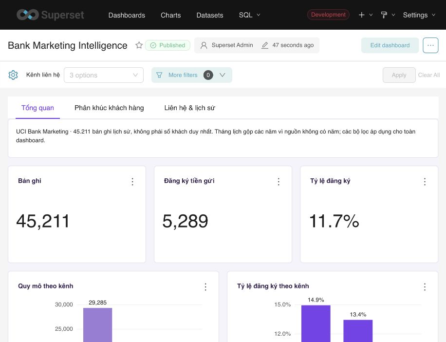

# Bank Marketing Intelligence

Project phân tích hiệu quả chiến dịch marketing từ **UCI Bank Marketing**, dùng **Python → PostgreSQL → Apache Superset**. Toàn bộ code, SQL, tài liệu và kiểm chứng nằm trong một folder để mở bằng VS Code.

[Mở dashboard Superset local](http://127.0.0.1:8088/superset/dashboard/bank-marketing-intelligence/)



## Kết quả đã thực hiện

| Chỉ tiêu | Kết quả |
|---|---:|
| Bản ghi nguồn và analytics | 45.211 |
| Đăng ký tiền gửi | 5.289 |
| Tỷ lệ đăng ký | 11,70% |
| Số lần liên hệ TB / bản ghi | 2,76 |
| Dòng trùng hoàn toàn | 0 |
| Bản ghi chưa rõ kênh | 13.020 |
| Kiểm tra dữ liệu | 18/18 |
| Đối soát Superset với SQL, 6 tình huống | 108/108 |
| Unit tests | 8/8 |

Một dòng là **bản ghi nguồn**, không phải khách duy nhất hoặc một cuộc gọi. Không có năm đầy đủ: biểu đồ tháng gộp năm, không phải xu hướng tháng liên tiếp. Phân tích mô tả, không chứng minh nhân quả hoặc ROI; chưa huấn luyện mô hình.

## Dashboard

- **Tổng quan:** số bản ghi/đăng ký/tỷ lệ, quy mô và tỷ lệ theo kênh/tháng lịch; bảng mẫu số và khoảng Wilson 95%.
- **Phân khúc khách hàng:** tỷ lệ theo nghề, tuổi, học vấn; mẫu số và khoảng 95% theo nghề.
- **Liên hệ & lịch sử:** số lần liên hệ và kết quả chiến dịch trước; quy mô và tỷ lệ tương ứng.

18 biểu đồ/bảng, 1 dataset ở grain gốc, 3 bộ lọc áp dụng tất cả chart: kênh, tháng lịch, nghề. Một tông **tím lavender**: tím mận `#35204F`, tím chính `#7C3AED`, tím nhạt `#9D7BD8`, tím phụ `#B79AD9`; nền `#F7F4FC`.

## Chạy trong VS Code

Yêu cầu **Python 3.11+**, Docker Desktop và môi trường PostgreSQL/Superset local đã cấu hình ở workspace. Mở folder này, terminal:

```bash
code .
bash run.sh all
```

`run.sh` tự tạo `.venv` và cài package khi chưa có. Trong VS Code cũng có các tác vụ **Bank BI: all / validate / tests**.

Các bước riêng:

```bash
bash run.sh download
bash run.sh bootstrap
bash run.sh load
bash run.sh dashboard
bash run.sh verify
bash run.sh report
.venv/bin/python -m unittest discover -s tests -v
```

### Môi trường local đang dùng

PostgreSQL tại `127.0.0.1:5432`, container `postgres-local`. Superset tại `127.0.0.1:8088`, container `superset_app`, cùng các dịch vụ `superset_db`, `superset_cache`. Nếu Docker vừa tắt, khởi động Docker Desktop rồi các container đã có. Project **không chứa toàn bộ cài đặt Superset**; chuyển máy cần cung cấp PostgreSQL và Superset tương thích hoặc cài stack trước.

`bootstrap` tạo database riêng `bank_marketing_intelligence`, role chủ sở hữu `bank_bi`, role BI chỉ đọc `bank_reader` và `.env` quyền 0600. Nó từ chối tên database/role đã tồn tại nhưng không mang marker project; không thay database Retail/Amazon/Olist. Không copy `.env.example` với mật khẩu rỗng để chạy bootstrap; để script tạo `.env` hoặc tự điền đầy đủ thông tin cho môi trường của bạn.

API Superset dùng `SUPERSET_ACCESS_TOKEN`, hoặc `SUPERSET_USERNAME`/`SUPERSET_PASSWORD`. Trong môi trường Docker local được phép, có thể tạo phiên ngắn hạn cho admin hiện có qua app context; không tạo user hay đổi mật khẩu. URI từ container đến PostgreSQL mặc định `host.docker.internal`, đổi bằng `SUPERSET_PGHOST` nếu môi trường khác.

`load` thay dữ liệu staging/fact trong transaction, giữ audit; không tự xóa unknown/ngoại lai. Rerun deploy giữ UUID/ID chart/dataset/dashboard. Dữ liệu và kết quả là lịch sử của nguồn UCI, không phải chiến dịch đang chạy năm 2026. Token, `.env`, virtualenv và raw data không đưa lên GitHub.

## Đọc code và báo cáo

- [Báo cáo theo 5 bước](docs/project_report.md): đã làm, bằng chứng, hạn chế, đề xuất bổ sung cho từng bước.
- [Data contract](docs/data-contract.md): grain, KPI, cleaning, kiểm chứng.
- `sql/01_staging.sql`, `02_analytics.sql`, `03_analysis.sql`: SQL thực thi và truy vấn phân tích.
- `bank_bi/source.py`, `rules.py`, `pipeline.py`: tải/kiểm tra/nạp dữ liệu.
- `bank_bi/dashboard_spec.py`, `dashboard.py`, `verify.py`: định nghĩa và triển khai Superset, đối soát tất cả chart.
- `source-manifest.json`: URL và hash đã ghim; `artifacts/`: bằng chứng chạy thật.

Nguồn: Moro, S., Rita, P., & Cortez, P. (2014). [Bank Marketing — UCI](https://archive.ics.uci.edu/dataset/222/bank+marketing). DOI [10.24432/C5K306](https://doi.org/10.24432/C5K306), **CC BY 4.0**. Chọn `bank-full.csv` (16 biến đầu vào + `y`), không ghép bản `bank-additional`.
